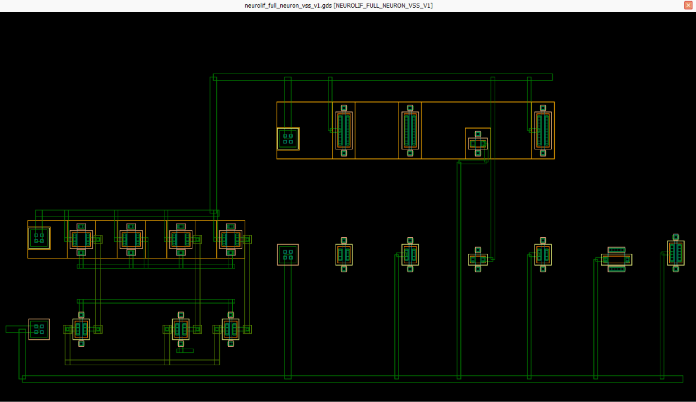
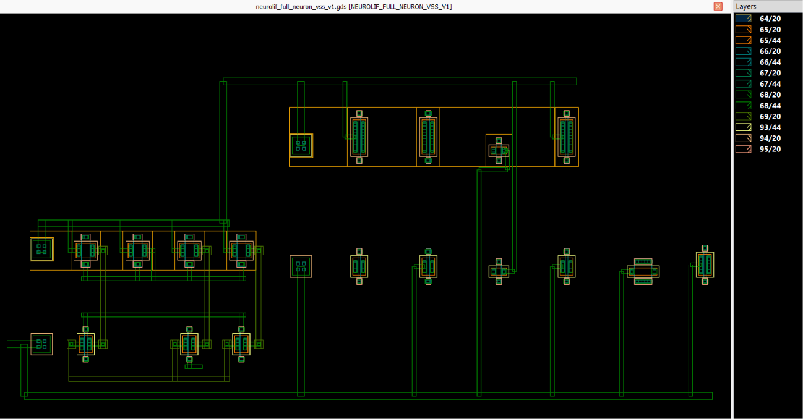
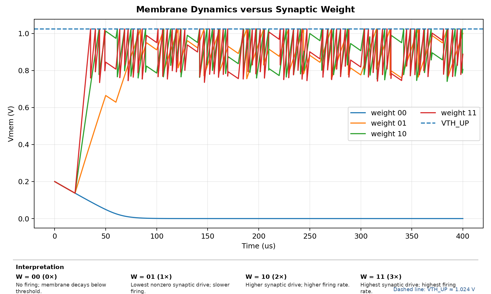
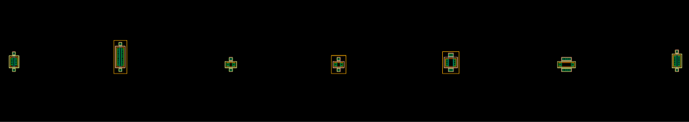
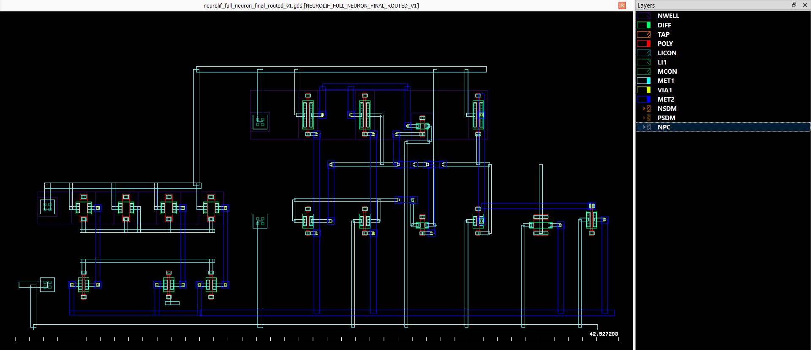
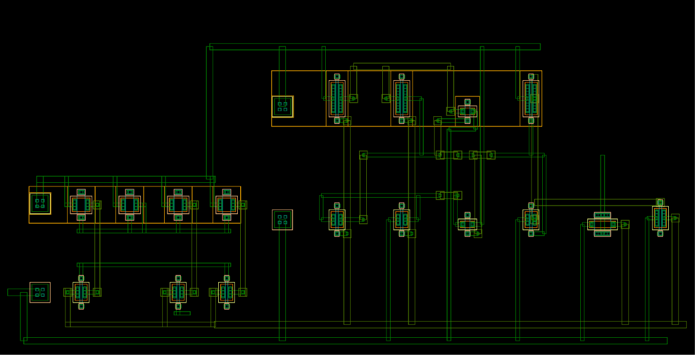
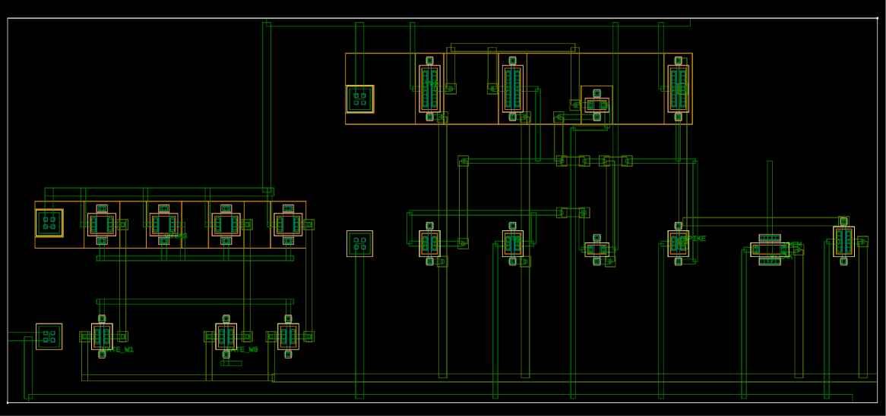

<div align="center">

# NeuroLIF-SKY130

### Transistor-Level Leaky Integrate-and-Fire Neuron  
### Weighted Synaptic Input · SKY130 Physical Design · DRC · Connectivity Audit · LVS

[](#physical-implementation)
[](#physical-implementation)
[](#physical-verification)
[](#physical-verification)
[](#highlights)
[](#license)

**Pre-silicon educational neuromorphic IC design using the open SKY130 PDK**

</div>

---

NeuroLIF-SKY130 implements a transistor-level **leaky integrate-and-fire (LIF) neuron** using SKY130 1.8 V CMOS devices.

The project covers the full design path from transistor-level circuit development and weighted-synapse characterization to physical layout, official SKY130 DRC, independent geometry-based connectivity verification and KLayout LVS.

The released core contains **17 MOS transistors**, exposes **8 external pins**, passes the official SKY130 DRC with **0 violations**, and matches the intended 17-MOS reference schematic under LVS.

<p align="center">
  
</p>

<p align="center">
  <em>Final routed NeuroLIF-SKY130 physical core in KLayout.</em>
</p>

---

## Highlights

| Metric | Result |
|---|---:|
| Technology | SKY130 1.8 V CMOS |
| Neuron model | Leaky integrate-and-fire |
| MOS devices | **17** |
| PFET / NFET | **8 / 9** |
| External pins | **8** |
| Logical conductor nets | **14** |
| Synaptic encoding | **0× / 1× / 2× / 3×** |
| Membrane capacitor | External ideal **5 pF** |
| Nominal Schmitt hysteresis | **199.852 mV** |
| PVT validation | **27 / 27** defined operating points passed |
| Deterministic variation | **13 / 13** cases passed |
| Official SKY130 DRC | **PASS — 0 violations** |
| Connectivity/topology audit | **PASS** |
| Cross-net shorts | **None detected** |
| Floating conductor nets | **None detected** |
| KLayout LVS | **PASS — Netlists match** |
| Extracted MOS count | **17 / 17** |

---

## Architecture

The final signal path is:

```text
Reference current
      |
      v
PMOS current mirror
      |
      v
2-bit weighted synapse
      |
      v
     VMEM
      |
      +-------> NMOS leak controlled by VLEAK
      |
      v
6T CMOS Schmitt detector
      |
      v
     VRAW
      |
      v
CMOS output inverter
      |
      v
    SPIKE
      |
      +-------> NMOS reset
                    |
                    v
                   VMEM
```

### Physical transistor composition

| Block | MOS count |
|---|---:|
| Weighted synapse | 7 |
| Membrane leak | 1 |
| Schmitt detector | 6 |
| Output inverter | 2 |
| Reset | 1 |
| **Total** | **17** |

The membrane capacitor is deliberately external to the physical core.

Nominal transistor-level simulations use:

```text
Cmem = 5 pF
```

Detailed architecture and circuit documentation:

- [`docs/architecture.md`](docs/architecture.md)
- [`docs/circuit_design.md`](docs/circuit_design.md)

---

## Weighted Electronic Synapse

The final 2-bit synapse uses **three identical PMOS unit-current cells**.

Two digital controls, `GATE_W0` and `GATE_W1`, produce four synaptic states:

| Code | Active unit cells | Logical weight | Nominal delivered current |
|---|---:|---:|---:|
| `00` | 0 | 0× | ~0.002 nA |
| `01` | 1 | 1× | ~103.734 nA |
| `10` | 2 | 2× | ~207.470 nA |
| `11` | 3 | 3× | ~311.206 nA |

> **Note:** `00` denotes the nominal **0× synaptic state**. The transistor-level simulation shows a residual off-state current of approximately **0.002 nA (~2 pA)** rather than mathematically zero current.

Measured current ratios:

```text
10 / 01 = 2.0000
11 / 01 = 3.0000
```

### Why identical unit cells?

Direct characterization showed that, for the tested SKY130 device configuration and bias conditions, a single PMOS with twice the unit width did not produce twice the unit current:

```text
Unit PMOS current       ≈ 103.738 nA
Single 2×-wide PMOS     ≈ 98.196 nA
Two identical unit PMOS ≈ 207.476 nA
```

The final 2× state therefore uses **two identical unit PMOS devices in parallel**.

This is an implementation-specific result and is not presented as a general statement about MOS current scaling with width.

<p align="center">
  
</p>

<p align="center">
  <em>Final routed 7-MOS weighted-synapse block.</em>
</p>

---

## Membrane Dynamics versus Synaptic Weight

The transistor-level transient response shows how synaptic weight changes the membrane-voltage dynamics:

- `00` — no firing; membrane voltage remains below threshold
- `01` — lowest nonzero synaptic drive and firing rate
- `10` — stronger drive and higher firing rate
- `11` — strongest drive and highest firing rate

The dashed line marks the nominal rising Schmitt threshold:

```text
VTH_UP = 1.023948 V
```

<p align="center">
  
</p>

<p align="center">
  <em>
    Original transistor-level VMEM waveforms for the four synaptic-weight states.
    The waveform data are unchanged; only presentation annotations were added outside the original plot region.
  </em>
</p>

---

## Membrane, Leak and Threshold Detection

`VMEM` is the principal neuron state variable.

Synaptic current charges the external membrane capacitor while an NMOS leak transistor provides a controllable discharge path.

### Leak device

```text
W = 0.42 µm
L = 1.00 µm
```

Leak strength is externally controlled through `VLEAK`.

### Schmitt detector

Threshold detection uses a corrected six-transistor CMOS Schmitt topology.

Final transistor-level switching points:

```text
VTH_UP     = 1.023948 V
VTH_DOWN   = 0.824096 V
Hysteresis = 199.852 mV
```

The approximately **200 mV hysteresis window** provides distinct rising and falling switching thresholds around the membrane transition.

---

## Spike Generation and Reset

The Schmitt detector generates the internal signal:

```text
VRAW
```

A CMOS inverter produces the externally available positive-going signal:

```text
SPIKE
```

The reset transistor is:

```text
MN_RST VMEM SPIKE VSS VSS
```

When `SPIKE` rises, the reset NMOS discharges `VMEM` toward `VSS`, initiating the next integrate-and-fire cycle.

A dedicated refractory-delay circuit is not included in the current revision.

---

## Nominal Functional Response

| Weight | Spike count | Firing rate |
|---|---:|---:|
| `00` | 0 | 0 Hz |
| `01` | 16 | 42.1 kHz |
| `10` | 39 | 102.6 kHz |
| `11` | 65 | 171.1 kHz |

Under nominal conditions, firing activity increases monotonically with the number of active synaptic unit cells.

---

## Robustness Characterization

```text
Post-patch nominal validation       PASS
Functional numerical convergence   PASS
PVT operating points                27 / 27 PASS
Deterministic variation cases       13 / 13 PASS
```

### PVT acceptance criterion

Each PVT operating point passes when:

1. the simulation completes successfully
2. weight `00` remains silent
3. weight `11` generates at least one valid output spike
4. firing response remains nondecreasing with increasing synaptic weight

Therefore:

> **27 / 27 PASS does not imply that intermediate weights `01` and `10` generate spikes at every individual PVT corner.**

The deterministic 13-case variation study is not presented as a Monte Carlo mismatch analysis.

### Frozen simulation results

```text
results/
├── nominal/
├── synapse/
├── pvt/
└── variation/
```

Clean result-analysis notebooks are available under:

```text
notebooks/
```

---

# Physical Design

## Physical Implementation

The physical implementation was developed in KLayout using the open SKY130 technology environment.

### Frozen development environment

| Tool | Version |
|---|---|
| KLayout | 0.30.12 |
| Python | 3.11.9 |
| gdsfactory | 8.4.0 |
| kfactory | 0.17.8 |

The project uses a dedicated seven-device MOS primitive library.

All final MOS primitives use:

```text
nf = 1
interdig = 0
```

<p align="center">
  
</p>

<p align="center">
  <em>Single-finger SKY130 MOS primitive library used by the physical-design flow.</em>
</p>

### Final routed core with layer view

<p align="center">
  
</p>

### Canonical physical artifact

```text
layout/neuron/neurolif_full_neuron_final_routed_v1.gds
```

Top cell:

```text
NEUROLIF_FULL_NEURON_FINAL_ROUTED_V1
```

Canonical SHA-256:

```text
74fcc1478c50e2fd590d333e576c99fd1fec03d72c43f3679c15fd50e8d9a6de
```

The canonical physical GDS is treated as frozen.

A separate labelled derivative is used only for LVS extraction:

```text
layout/neuron/neurolif_full_neuron_lvs_v1.gds
```

---

# Verification

## Physical Verification

The final core is closed using three complementary verification mechanisms:

```text
Official SKY130 DRC
        +
Independent geometry/connectivity audit
        +
KLayout LVS
```

### 1. Official SKY130 DRC

Final result:

```text
PASS
0 violations
```

<p align="center">
  
</p>

### 2. Independent Geometry-Based Connectivity Audit

The audit independently checks:

- 17 expected MOS devices
- 14 intended logical conductor nets
- M1 / VIA1 / M2 connectivity
- weighted-synapse topology
- Schmitt, buffer, leak and reset topology
- PMOS NWELL/body connectivity
- NMOS substrate/body connectivity
- cross-net shorts
- unexplained floating conductor networks

Final result:

```text
17 MOS devices           VERIFIED
14 logical nets          VERIFIED

Cross-net shorts         NONE DETECTED
Floating conductor nets  NONE DETECTED
Body/well connectivity   VERIFIED
```

### 3. KLayout LVS

The labelled LVS derivative was extracted and compared against the intended 17-MOS reference schematic.

```text
MOS total = 17 / 17
PFET      = 8 / 8
NFET      = 9 / 9

OFFICIAL RESULT:
NETLISTS MATCH
```

Authoritative KLayout result:

```text
INFO : Congratulations! Netlists match.
```

<p align="center">
  
</p>

### Verification summary

| Check | Result |
|---|---|
| Official SKY130 DRC | **PASS** |
| DRC violations | **0** |
| Geometry connectivity audit | **PASS** |
| Logical conductor nets | **14 / 14** |
| Cross-net shorts | **None detected** |
| Floating conductor nets | **None detected** |
| Body/well connectivity | **PASS** |
| Official KLayout LVS | **PASS** |
| LVS comparison | **Netlists match** |
| Extracted MOS | **17 / 17** |
| External pins | **8 / 8** |

Detailed evidence:

```text
verification/neuron/
verification/synapse/
```

Machine-readable logs, databases, extracted netlists and JSON records are the primary verification evidence. Screenshots are supporting presentation material.

---

## Why DRC Alone Was Not Treated as Sufficient

During development, one intermediate VDD-routed layout was DRC-clean while an intended `MN_FB` VDD connection was still missing.

A later VRAW route also created an unintended `VRAW`-to-`VSS` MET1 short that was isolated by the independent geometry audit.

These cases motivated the final verification strategy:

```text
DRC
 +
independent geometry/connectivity audit
 +
LVS
```

rather than relying on design-rule checking alone.

---

## External Interface

| Pin | Function |
|---|---|
| `VDD` | 1.8 V supply |
| `VSS` | Ground |
| `VBIAS` | PMOS current-mirror bias |
| `GATE_W0` | 1× synaptic-weight control |
| `GATE_W1` | 2× synaptic-weight control |
| `VLEAK` | Leak bias |
| `VMEM` | Membrane node / external capacitor terminal |
| `SPIKE` | Neuron spike output |

---

## Repository Structure

```text
NeuroLIF-SKY130/
│
├── circuit/       # reference and LVS schematics
├── docs/          # detailed technical documentation
├── figures/       # layout, simulation and verification figures
├── layout/        # canonical GDS/OASIS artifacts
├── notebooks/     # clean result-analysis notebooks
├── results/       # frozen simulation summaries
├── scripts/       # physical construction and verification scripts
├── verification/  # DRC, connectivity and LVS evidence
│
├── CITATION.cff
├── LICENSE
└── README.md
```

### Documentation

- [`docs/architecture.md`](docs/architecture.md)
- [`docs/circuit_design.md`](docs/circuit_design.md)
- [`docs/physical_design.md`](docs/physical_design.md)
- [`docs/verification.md`](docs/verification.md)
- [`docs/reproducibility.md`](docs/reproducibility.md)

---

## Reproducibility

The curated repository supports inspection and reproduction of the final verification workflow.

### Final DRC

```text
scripts/klayout/run_final_drc.py
```

### Final LVS

```text
scripts/klayout/run_final_lvs.py
```

### Full-Neuron Connectivity Audit

```text
scripts/verification/neuron/
audit_full_neuron_connectivity_v1.py
```

The repository also preserves the successful physical-design lineage.

Some historical intermediate GDS files and manifests are intentionally omitted from the curated release. The repository therefore should not be interpreted as a complete one-command replay of every historical routing stage from a fresh clone.

See:

[`docs/reproducibility.md`](docs/reproducibility.md)

for the exact reproducibility boundary and frozen tool versions.

---

## Research Context

Neuromorphic silicon circuits use transistor-level physical dynamics to implement neuron-like state integration, thresholding and spike generation.

NeuroLIF-SKY130 is an educational open-PDK implementation focused on:

- transistor-level neuron behavior
- weighted electronic synaptic input
- membrane integration and leak
- hysteretic threshold detection
- spike generation and reset
- physical layout
- reproducible verification

The project is **not presented as a new general neuron model or as a fabricated neuromorphic processor**.

---

## References

1. C. Mead, “Neuromorphic Electronic Systems,” *Proceedings of the IEEE*, vol. 78, no. 10, pp. 1629–1636, 1990. DOI: `10.1109/5.58356`.

2. G. Indiveri et al., “Neuromorphic Silicon Neuron Circuits,” *Frontiers in Neuroscience*, vol. 5, art. 73, 2011. DOI: `10.3389/fnins.2011.00073`.

3. SkyWater Technology / Google, *SkyWater SKY130 Open Source PDK Documentation*.

---

## Scope and Limitations

NeuroLIF-SKY130 is a **pre-silicon educational neuromorphic circuit-design project**.

### Supported claims

- transistor-level LIF-neuron simulation
- weighted-synapse characterization
- nominal functional validation
- defined PVT validation
- deterministic-variation validation
- physical-layout implementation
- official SKY130 DRC with zero violations
- independent geometry/connectivity verification
- successful KLayout LVS

### Not claimed

- fabricated silicon
- tapeout
- measured post-silicon performance
- commercial manufacturing signoff
- Monte Carlo mismatch validation
- parasitic-extracted post-layout transient simulation

PEX and post-layout simulation remain possible future extensions.

---

## License

Released under the **MIT License**.

See [`LICENSE`](LICENSE).

---

## Citation

A machine-readable citation record is provided in [`CITATION.cff`](CITATION.cff).

If this repository is used in academic or research work, please cite the project using that record.
